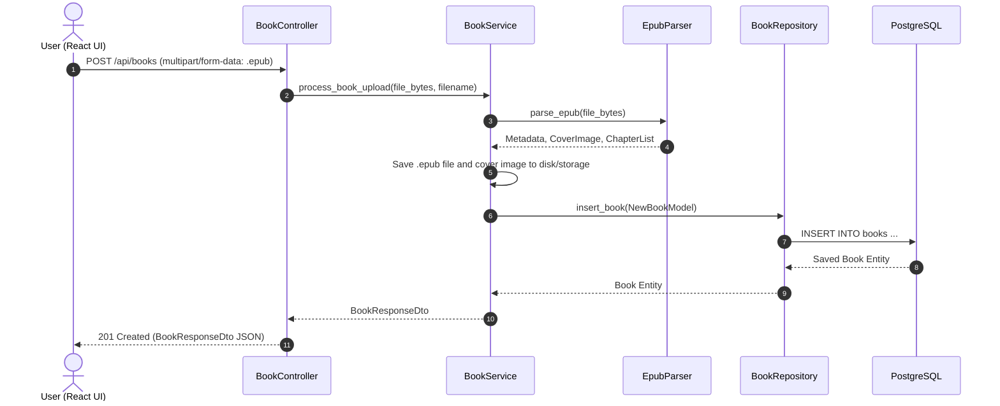
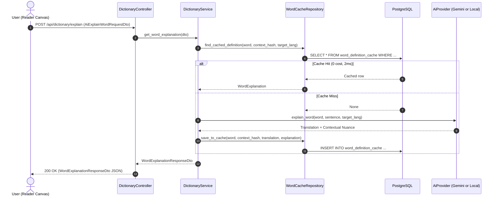
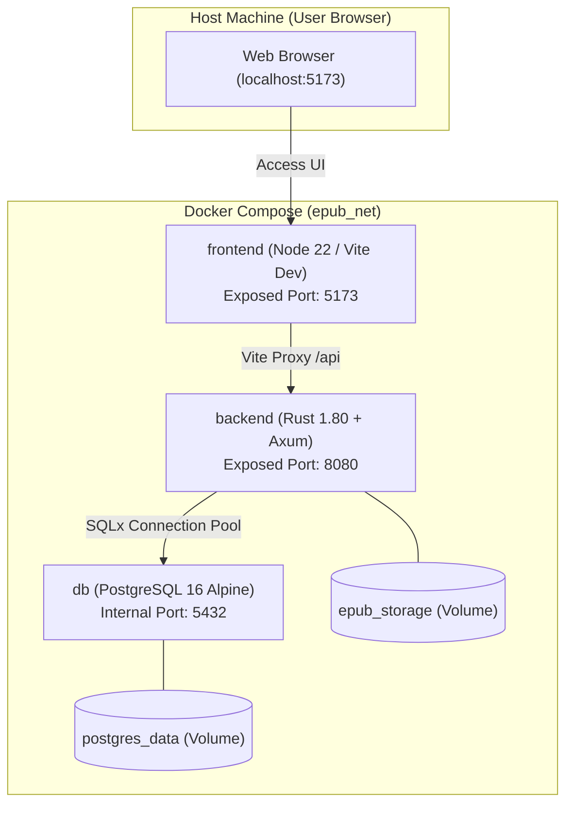

# EPUB Reader - System Architecture & Backend Design

## 1. Architectural Overview

The backend is built in **Rust** following the industry-standard **Layered Architecture (N-Tier)**:
```
[ Frontend: React Container ]
        │  ▲
        │  │  HTTP REST / JSON (DTOs)
        ▼  │
[ Controllers / Handlers ]
        │  ▲
        │  │  Input DTOs / Service Result DTOs
        ▼  │
[ Business Services ] ────► [ Pluggable AI Engine (Trait) ]
        │  ▲                         ├── GeminiProvider (API Key)
        │  │                         └── LocalModelProvider (Ollama/GGUF)
        ▼  │
[ Repositories (Data Access) ]
        │  ▲
        │  │  SQLx Queries / Connection Pool
        ▼  │
[ Database: PostgreSQL Container ]
```

---

## 2. Layer Responsibilities & Boundaries

### 2.1 Presentation / Controller Layer (`src/controllers/`)
- Exposes RESTful HTTP endpoints using **Axum**.
- Validates incoming HTTP requests and deserializes payloads into **Request DTOs** using `serde::Deserialize`.
- Invokes corresponding methods in the **Service Layer**.
- Wraps output into **Response DTOs** with standard HTTP status codes (`200 OK`, `201 Created`, `400 Bad Request`, `404 Not Found`, `500 Internal Error`).
- Does **not** contain business logic, database queries, or SQL statements.

### 2.2 Data Transfer Objects (DTOs) Layer (`src/dtos/`)
- Plain Rust structs representing API contract payloads between client and server.
- Decouples internal database entities (models) from public API contracts.
- Categorized into:
  - **Request DTOs**: `UploadBookDto`, `UpdateProgressDto`, `TranslateWordDto`, `AiExplainWordDto`.
  - **Response DTOs**: `BookResponseDto`, `ChapterResponseDto`, `WordExplanationResponseDto`, `ApiResponse<T>`.

### 2.3 Service Layer (`src/services/`)
- Implements core domain and application business rules.
- Coordinates complex workflows:
  - EPUB archive decompression and XML parsing (`META-INF/container.xml`, `.opf` package, spine, TOC).
  - Sanitizing chapter XHTML for safe web rendering.
  - Calling the **Pluggable AI Engine** for contextual definitions and checking/saving into PostgreSQL definition cache.
- Coordinates transactions across multiple repositories if necessary.

### 2.4 Pluggable AI & Translation Engine (`src/services/ai/`)
To ensure high scalability and zero lock-in, AI operations use the **Strategy Pattern** via Rust's dynamic dispatch (`Box<dyn AiProvider>` or `Arc<dyn AiProvider>`):

```rust
#[async_trait::async_trait]
pub trait AiProvider: Send + Sync {
    async fn explain_word(
        &self, 
        word: &str, 
        sentence_context: &str, 
        target_lang: &str
    ) -> Result<AiExplanationResult, AppError>;

    async fn translate_word(
        &self,
        word: &str,
        target_lang: &str
    ) -> Result<TranslationResult, AppError>;
}
```

- **`GeminiProvider` (Default)**: Uses `reqwest` to call the Google Gemini API with `GEMINI_API_KEY`.
- **`LocalModelProvider` (Offline / Self-Hosted)**: Connects to local runners (e.g. Ollama, llama.cpp / llama-server, or local Hugging Face model endpoint) at `LOCAL_MODEL_URL`.
- **Provider Factory (`create_ai_provider(config: &Config)`)**: Reads `AI_PROVIDER` from configuration (`gemini` or `local`). **Switching providers requires only changing a single environment variable.**

### 2.5 Repository Layer (`src/repositories/`)
- Encapsulates all data access logic for **PostgreSQL**.
- Uses **SQLx** with connection pooling (`PgPool`) for compile-time verified, async queries.
- Defined via Rust `traits` (interfaces) allowing for mockable unit testing:
  - `BookRepositoryTrait`
  - `ProgressRepositoryTrait`
  - `WordCacheRepositoryTrait`
  - `VocabularyRepositoryTrait`

### 2.6 Database Layer (`PostgreSQL`)
- Persistent storage for book metadata, reading states, cached translations, and user vocabulary.

---

## 3. Project Directory Structure

```
epub_reader/
├── docker-compose.yml                 # 1-command startup orchestration
├── .env.example                       # Root environment template
├── .gitignore
├── books/                             # Test EPUB library dataset
├── docs/                              # Architecture and design specifications
├── backend/
│   ├── Dockerfile                     # Multi-stage Rust build container
│   ├── Cargo.toml
│   ├── migrations/                    # SQLx schema migrations
│   └── src/
│       ├── main.rs
│       ├── config.rs
│       ├── error.rs
│       ├── dtos/
│       ├── models/
│       ├── controllers/
│       ├── services/
│       │   └── ai/
│       └── repositories/
└── frontend/
    ├── Dockerfile                     # Vite React dev container
    ├── package.json
    ├── vite.config.ts
    ├── tailwind.config.js
    └── src/
        ├── main.tsx
        ├── App.tsx
        ├── components/
        ├── services/
        └── types/
```

---

## 4. DTO Specifications (Rust Signatures)

```rust
// src/dtos/dictionary_dto.rs
use serde::{Deserialize, Serialize};

#[derive(Debug, Deserialize)]
pub struct TranslateWordRequestDto {
    pub word: String,
    pub target_language: String, // e.g., "id", "es", "en"
}

#[derive(Debug, Deserialize)]
pub struct AiExplainWordRequestDto {
    pub word: String,
    pub sentence_context: String,
    pub target_language: String,
}

#[derive(Debug, Serialize)]
pub struct WordExplanationResponseDto {
    pub word: String,
    pub phonetic: Option<String>,
    pub direct_translation: String,
    pub contextual_explanation: String,
    pub example_usage: Option<String>,
    pub provider_used: String, // "gemini" or "local"
    pub is_cached: bool,
}

// src/dtos/book_dto.rs
#[derive(Debug, Serialize)]
pub struct BookResponseDto {
    pub id: String,
    pub title: String,
    pub author: String,
    pub description: Option<String>,
    pub cover_url: Option<String>,
    pub progress_percentage: f32,
    pub last_read_at: Option<chrono::DateTime<chrono::Utc>>,
}
```

---

## 5. PostgreSQL Database Schema

```sql
-- Books Table
CREATE TABLE IF NOT EXISTS books (
    id UUID PRIMARY KEY DEFAULT gen_random_uuid(),
    title VARCHAR(255) NOT NULL,
    author VARCHAR(255) NOT NULL DEFAULT 'Unknown Author',
    description TEXT,
    language VARCHAR(10) DEFAULT 'en',
    file_path VARCHAR(500) NOT NULL,
    cover_image_path VARCHAR(500),
    total_chapters INT NOT NULL DEFAULT 0,
    created_at TIMESTAMPTZ NOT NULL DEFAULT NOW(),
    updated_at TIMESTAMPTZ NOT NULL DEFAULT NOW()
);

-- Reading Progress Table
CREATE TABLE IF NOT EXISTS reading_progress (
    id UUID PRIMARY KEY DEFAULT gen_random_uuid(),
    book_id UUID NOT NULL REFERENCES books(id) ON DELETE CASCADE,
    current_chapter_index INT NOT NULL DEFAULT 0,
    current_cfi VARCHAR(255),
    progress_percentage REAL NOT NULL DEFAULT 0.0,
    last_read_at TIMESTAMPTZ NOT NULL DEFAULT NOW(),
    CONSTRAINT unique_book_progress UNIQUE (book_id)
);

-- Word Definition & AI Explanation Cache
CREATE TABLE IF NOT EXISTS word_definition_cache (
    id UUID PRIMARY KEY DEFAULT gen_random_uuid(),
    word VARCHAR(100) NOT NULL,
    context_hash VARCHAR(64) NOT NULL, -- SHA-256 hash of surrounding sentence
    target_language VARCHAR(10) NOT NULL,
    direct_translation TEXT NOT NULL,
    ai_context_explanation TEXT NOT NULL,
    provider VARCHAR(50) NOT NULL DEFAULT 'gemini',
    created_at TIMESTAMPTZ NOT NULL DEFAULT NOW(),
    CONSTRAINT unique_word_context_lang UNIQUE (word, context_hash, target_language)
);

-- User Starred Vocabulary Table
CREATE TABLE IF NOT EXISTS user_vocabulary (
    id UUID PRIMARY KEY DEFAULT gen_random_uuid(),
    book_id UUID REFERENCES books(id) ON DELETE SET NULL,
    word VARCHAR(100) NOT NULL,
    sentence_context TEXT NOT NULL,
    translation TEXT NOT NULL,
    ai_explanation TEXT NOT NULL,
    saved_at TIMESTAMPTZ NOT NULL DEFAULT NOW()
);

CREATE INDEX idx_books_updated_at ON books(updated_at DESC);
CREATE INDEX idx_cache_lookup ON word_definition_cache(word, target_language);
```

---

## 6. Sequence Diagrams

### 6.1 Book Upload & Ingestion Flow


### 6.2 1-Click Translation & AI Definition Flow (Pluggable Engine)


---

## 7. Containerization & Docker Orchestration

The entire system is orchestrated with **Docker Compose**, running 3 interconnected services inside a private bridge network (`epub_net`):



- **Health Checks & Startup Order**: The `backend` container waits for `db` to pass its health check (`pg_isready`) before initiating migrations and starting the HTTP server.
- **Single Command Operation**: Running `docker compose up --build` handles building, networking, database migration, and frontend serving without requiring Rust, Cargo, or PostgreSQL on the host OS.
